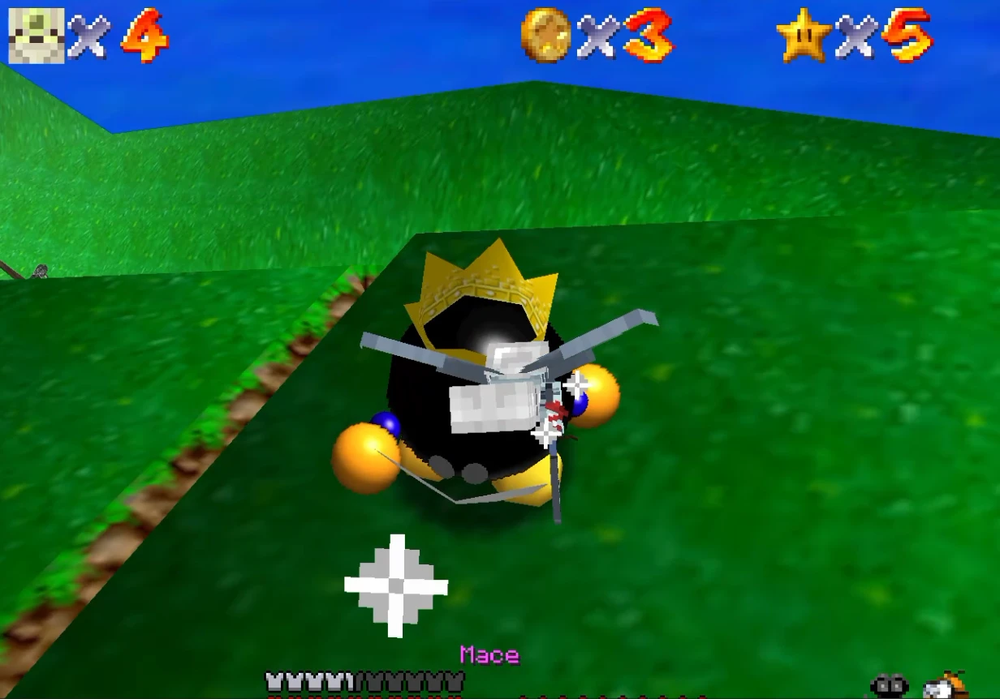

# MarioCraft

Play Super Mario 64 as Minecraft's Steve.

**[⬇ Download the latest version](../../releases/latest)**: get `MarioCraft-<version>-source.zip` and follow [Install](#install).

> **Built on [SkyCraft](https://github.com/chasmlol/SkyCraft) by chasm.** SkyCraft came up with the idea of a hidden Minecraft playing inside another game, and built the link between them that MarioCraft uses. All credit for that goes to chasm. Go check out SkyCraft!

MarioCraft runs Super Mario 64 (through [sm64coopdx](https://github.com/coop-deluxe/sm64coopdx)) with a hidden Minecraft running alongside it, the way SkyCraft does with Skyrim. Steve replaces Mario. He moves, fights, mines, builds and takes damage the Minecraft way, while everything in Mario's world (levels, enemies, bosses, stars, cannons, slides, caps) still works the SM64 way. You can beat the whole game as Steve, alone or with friends.

**No game files are included.** You build MarioCraft yourself from your own Super Mario 64 ROM, and play it with your own Minecraft: Java Edition account.

> **Status: new and experimental.** Expect rough edges, and back up your saves (see [Your saves](#your-saves)). Found a bug? [Open an issue](../../issues/new/choose).
> MarioCraft is a fan project. It isn't affiliated with Nintendo, Mojang Studios or Microsoft, and you need to own both games.

## What it does

- **Steve in every level.** Minecraft movement, hearts, hunger, armour and inventory, in all of SM64's courses, the castle and the Bowser stages.
- **Mario's moves the Minecraft way:**
  - double jump, triple jump, long jump, backflip and wall kicks;
  - ground pound;
  - butt-sliding down slides;
  - poles, cannons, Hoot and Koopa shells.
- **Fighting.** Swords, axes, bows and the mace work on Goombas, Bob-ombs, Bullies, Boos and the rest.
- **Bosses.** Every boss can be beaten with Minecraft weapons. The mace takes a life with every hit; swords wear a boss down. Bowser is still thrown by the tail into his bombs.
- **Mining and building.** Mine Mario's world (castle walls drop stone or quartz bricks, stair rails drop fences, grass gives dirt...) and build in it. Placed blocks are solid to SM64.
- **Power-ups.** Mario's caps become Minecraft effects: the wing cap gives flight, the metal cap gives Resistance and Fire Resistance, the vanish cap gives Invisibility.
- **Coins and hearts** heal Steve and feed him. Underwater levels give Water Breathing.
- **Losing a life works like Mario's**, with Minecraft-style messages ("Steve was chomped by a Chain Chomp").
- **Minecraft's mobs fight on your side.** Hostile mobs (zombies, skeletons, creepers, even the Wither) attack SM64's enemies, never players.
- **C418's music** in place of SM64's, picked for each level, and Minecraft sounds throughout.
- **Multiplayer.** Your friends' Minecraft joins the host's world automatically, so you see each other's skins and beat the game together.

## You need

- **Windows 10 or 11** (64-bit) and about 6 GB of free space.
- **Your own Super Mario 64 (USA) ROM** (a `.z64`, `.n64` or `.v64` file, any name).
- **Minecraft: Java Edition** (an account that owns it) and **[Prism Launcher](https://prismlauncher.org)**, signed in to that account once.
- **[MSYS2](https://www.msys2.org)**, installed to `C:\msys64`. This builds SM64; the installer adds the packages it needs.
- **[Java 25](https://adoptium.net)** (Temurin JDK 25). This builds the Minecraft mod.

## Install

1. Install MSYS2, Java 25 and Prism Launcher (links above). Open Prism once and sign in to your Microsoft account. If you skip this, `install.bat` checks first: it opens the download page for anything missing and tells you exactly what to pick.
2. Put the `MarioCraft` folder from the zip at **`C:\MarioCraft`**, or anywhere with a short path that has **no spaces**. SM64's build fails in folders like `C:\Users\John Smith\...` or deeply nested ones, and the installer will tell you if yours won't work.
3. Put your Super Mario 64 (USA) ROM in that folder, next to `install.bat`. Any file name works, and `.z64`, `.n64` and `.v64` dumps are all accepted.
4. Double-click **`install.bat`**.

The installer:
1. downloads sm64coopdx v1.5.1 and SkyCraft v0.1.2 from GitHub;
2. applies MarioCraft's changes from the `patches` folder;
3. builds SM64 from your ROM and builds the Minecraft mod;
4. adds a **MarioCraft** instance to Prism Launcher.

The first run takes 20–40 minutes, and later runs are quick. To update MarioCraft, replace the `patches` folder (and the other files here) with a newer release and run `install.bat` again.

## Play

Double-click **`MarioCraft Launcher.exe`** and press **Play**. SM64 opens, and Minecraft starts hidden in the background (the first start takes a minute). Steve's skin comes from the account signed in to Prism.

### Controls

Minecraft's controls, plus:

| | |
|---|---|
| Double / triple jump | Space again right as you land (triple: while running) |
| Long jump | Shift + Space while running |
| Backflip | Shift + Space standing still |
| Wall kick | Space in the air against a wall |
| Ground pound | Hold Shift as you land from a jump or fall |
| Talk, pick up (MIPS, baby penguin) | Right-click |
| Steer a slide, cannon or shell | WASD and the mouse; Space jumps off |
| SM64's pause menu (Exit Course) | P |
| Camera (first / third person) | F5 |
| Show the debug status line (for bug reports) | F7 |

### Multiplayer

Everyone needs MarioCraft installed. One player hosts in sm64coopdx (Host on the main menu) and the others join as usual. Each player's Minecraft joins the host's world by itself, through e4mc. No Minecraft server or port forwarding is needed.

### Your saves

- **Mario progress:** `%APPDATA%\sm64coopdx\sm64_save_file.bin`
- **Minecraft world:** the `saves\MarioCraft` folder in Prism's MarioCraft instance

## If something goes wrong

- **The installer stops with "PROBLEM: …"** It says what's missing. Fix that and run `install.bat` again.
- **A build failed.** See `sm64coopdx-build.log` or `minecraft-mod-build.log` in this folder.
- **"Prism Launcher wasn't found."** Install Prism (the normal installer, not the portable one), sign in once, then run `install.bat` again.

## Credits

- **[sm64coopdx](https://github.com/coop-deluxe/sm64coopdx)** by the Coop Deluxe team, built on the [Super Mario 64 decompilation](https://github.com/n64decomp/sm64).
- **[SkyCraft](https://github.com/chasmlol/SkyCraft)** by **chasm** ([chasmlol](https://github.com/chasmlol), MIT License). The original Minecraft-inside-another-game mod. MarioCraft's Minecraft mod is SkyCraft with MarioCraft's changes on top: the shared-memory link, the collision and rendering exchange, the combat stand-ins and the Prism setup are all chasm's work.
- **[Fabric](https://fabricmc.net)**, **[Fabric API](https://github.com/FabricMC/fabric)**, **[e4mc](https://github.com/vgskye/e4mc-minecraft-architectury)** and **[Prism Launcher](https://prismlauncher.org)**.

MarioCraft's own code is under the MIT License (`LICENSE`). sm64coopdx and SkyCraft stay under their own terms. See `THIRD-PARTY-NOTICES.md` and the `licenses` folder.

MarioCraft is a fan project. It is not affiliated with or endorsed by Nintendo, Mojang Studios or Microsoft. Super Mario 64 is a trademark of Nintendo; Minecraft is a trademark of Mojang Studios. No Nintendo or Mojang game data is included. Super Mario 64 comes from your own ROM, and Minecraft (with its music) from your own copy of the game.
